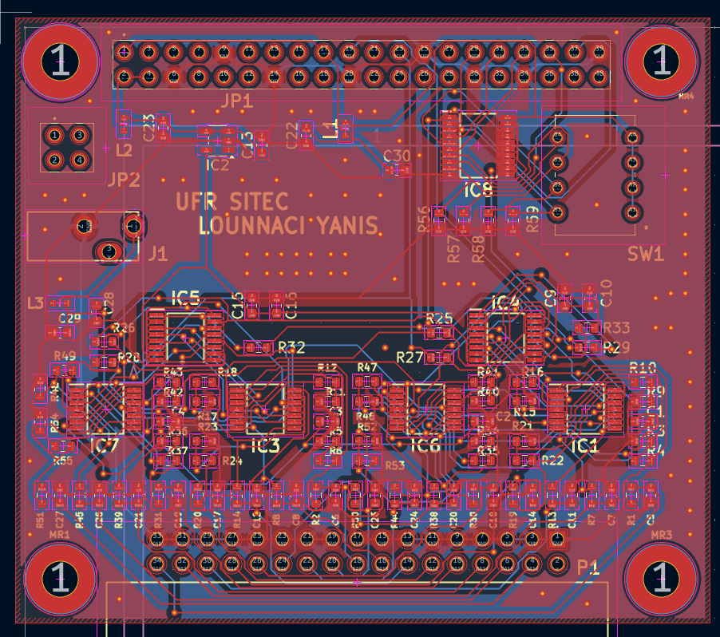

# Carte ANA – Conception électronique et PCB sous KiCad

## Présentation

Ce projet présente la conception d'une carte électronique ANA sous KiCad.

La conception a été menée en grande autonomie, depuis l'étude des composants et des datasheets jusqu'à la réalisation du schéma électronique, du PCB, du routage, des vérifications et de la préparation des fichiers de fabrication.

La carte est compatible avec une Raspberry Pi 3 et intègre différents composants électroniques permettant de générer et distribuer les signaux nécessaires à son fonctionnement.

Le travail réalisé couvre l'ensemble des principales étapes de conception d'un PCB :

- sélection des composants ;
- étude des datasheets ;
- création du schéma électronique ;
- gestion des symboles et empreintes ;
- placement des composants ;
- routage du PCB ;
- vérifications électriques ;
- visualisation 3D ;
- génération des fichiers de fabrication.

---

## 1. Sélection des composants

La première étape consiste à identifier les composants nécessaires et leurs références exactes.

Pour chaque composant, plusieurs éléments sont vérifiés :

- caractéristiques électriques ;
- tension d'alimentation ;
- boîtier / package ;
- brochage ;
- dimensions mécaniques ;
- disponibilité du symbole KiCad ;
- disponibilité de l'empreinte PCB ;
- disponibilité du modèle 3D.

Les datasheets constructeur sont utilisées pour vérifier la compatibilité des composants avec le circuit.

---

## 2. Création du schéma électronique

Le schéma électronique est réalisé avec **KiCad Schematic Editor**.

Les différents composants sont intégrés puis reliés selon l'architecture électrique de la carte.

Cette étape comprend notamment :

- ajout des symboles électroniques ;
- organisation fonctionnelle du schéma ;
- connexion des alimentations ;
- connexion des signaux ;
- vérification du brochage des composants.


---

## 3. Gestion des bibliothèques KiCad

Certains composants nécessitent l'ajout de bibliothèques externes.

Pour chaque composant, trois éléments peuvent être intégrés :

- symbole `.kicad_sym` ;
- empreinte `.kicad_mod` ;
- modèle 3D.

Les bibliothèques peuvent être ajoutées directement au projet afin de conserver une conception organisée et facilement réutilisable.

---

## 4. Affectation des empreintes

Après la réalisation du schéma, une empreinte physique est associée à chaque composant.

Cette étape permet de faire correspondre :

**Symbole électronique → composant réel → empreinte PCB**

Une attention particulière est portée :

- au type de boîtier ;
- aux dimensions ;
- à l'espacement des broches ;
- à l'orientation du composant.

---

## 5. Vérification électrique – ERC

Avant de passer au PCB, le schéma est vérifié avec l'outil **ERC – Electrical Rules Checker** de KiCad.

Cette vérification permet de détecter notamment :

- connexions manquantes ;
- erreurs de connexion ;
- incompatibilités entre certaines broches ;
- problèmes liés aux alimentations.

L'objectif est de corriger les erreurs du schéma avant de commencer le routage.


---

## 6. Placement des composants

Après importation du schéma dans l'éditeur PCB, les composants sont positionnés sur la carte.

Le placement est réalisé en tenant compte de plusieurs contraintes :

- encombrement de la carte ;
- proximité entre composants associés ;
- position des connecteurs ;
- longueur des pistes ;
- facilité de routage ;
- organisation générale du PCB.


---

## 7. Routage du PCB

Les différentes connexions électriques sont ensuite transformées en pistes de cuivre.

Le routage comprend :

- connexion des composants ;
- optimisation du chemin des pistes ;
- utilisation des différentes couches du PCB ;
- ajout de vias lorsque nécessaire ;
- organisation des pistes afin de limiter les croisements.



---

## 8. Utilisation des vias

Les vias permettent de faire passer une connexion électrique d'une couche du PCB à une autre.

Ils sont utilisés lorsque certaines pistes ne peuvent pas rester sur la même couche ou lorsque le routage nécessite un changement de couche.

L'utilisation des vias permet d'améliorer l'organisation du PCB et de simplifier certaines connexions.

---

## 9. Visualisation 3D

Une fois le PCB conçu, le modèle 3D de la carte est généré avec KiCad.

Cette vue permet de vérifier :

- la position des composants ;
- leur orientation ;
- les modèles 3D ;
- les connecteurs ;
- l'encombrement général de la carte ;
- les éventuelles collisions mécaniques.


---

## 10. Préparation à la fabrication

Après validation du PCB, les fichiers nécessaires à la fabrication sont générés.

KiCad permet notamment d'exporter :

- fichiers Gerber ;
- couches cuivre ;
- solder mask ;
- sérigraphie ;
- contour de la carte ;
- fichiers de perçage.

Les différents fichiers sont ensuite regroupés dans une archive `.zip`.

Cette archive peut être envoyée à un fabricant de PCB pour produire physiquement la carte.

---

## Workflow de conception

```text
Sélection des composants
        ↓
Analyse des datasheets
        ↓
Schéma électronique
        ↓
Symboles + empreintes
        ↓
Vérification ERC
        ↓
Placement PCB
        ↓
Routage
        ↓
Vias
        ↓
Vérification du PCB
        ↓
Modèle 3D
        ↓
Gerber + fichiers de perçage
        ↓
Fichiers prêts pour fabrication
